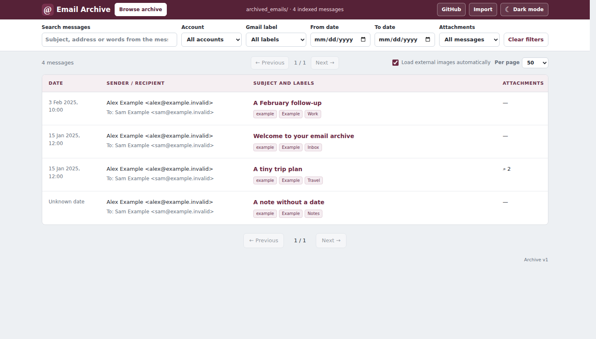
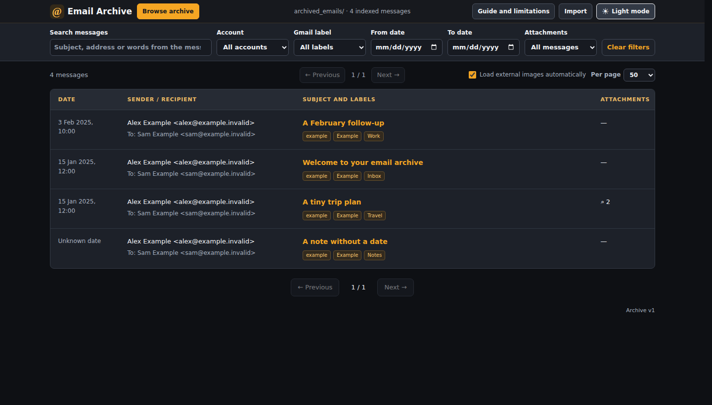
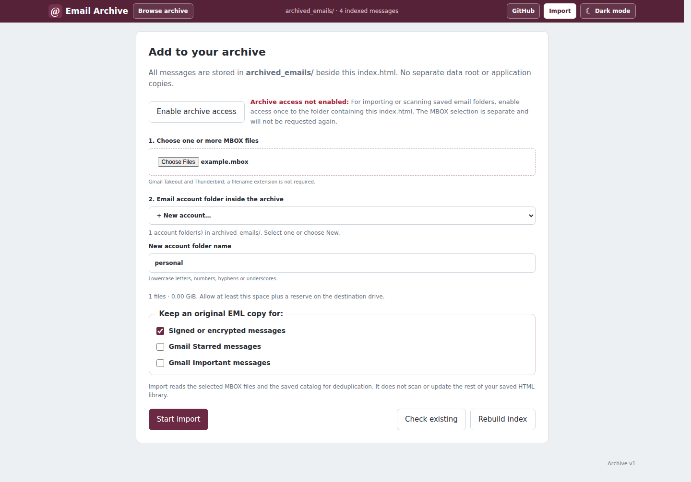

<div align="center">


# Freedom Email Archiver

**Your email. Your files. Your freedom.**

A private, portable, searchable email archive that runs right in your browser.

[](LICENSE)
[](#why-freedom-email-archiver)
[](https://github.com/nibage/freedom_email_archiver/actions/workflows/archive-tests.yml)

[Download ZIP](https://github.com/nibage/freedom_email_archiver/archive/refs/heads/main.zip) · [Quick start](#quick-start) · [User guide](GUIDE.html) · [Technical details](docs/TECHNICAL.md)

</div>



## Why Freedom Email Archiver?

Your email contains years of memories, documents and information. Keep a copy that you can open without an email provider, subscription, database server or internet connection.

| Feature | What it means for you |
| --- | --- |
| **Local and portable** | Everything lives in one folder. Copy it to another drive or computer. |
| **Searchable** | Find messages by subject, address, body text, account, Gmail label, date or attachments. |
| **Incremental imports** | Add new MBOX exports without duplicating existing messages. Gmail labels are merged. |
| **Readable files** | Each message is a standalone HTML file with its own local attachments. |
| **Multiple accounts** | Keep personal, work and other email archives together, or in separate portable folders. |
| **Recoverable indexes** | Removed accounts disappear automatically with archive access; copy complete indexed accounts or rebuild damaged indexes without an MBOX. |
| **Light & dark mode** | A compact, comfortable reading interface with remembered browsing position. |
| **Optional EML copies** | Preserve selected signed, encrypted, starred or important messages in original-message format. |

## See it in action

### Browse and search

The compact filter bar stays available while you scroll. Find the right message, open it and return to the same results page.



### Read your saved emails

Open messages directly in the browser, with local attachments and safe HTML formatting. The surrounding reader follows your selected theme.


### Import and maintain your library

Import MBOX files, select an account, choose optional EML retention and track progress. Check existing files or rebuild the index whenever needed.



*Screenshots use only the four fictional demonstration messages included in this repository.*

## Quick start

No installation or account is required.

1. [Download the ZIP](https://github.com/nibage/freedom_email_archiver/archive/refs/heads/main.zip) and extract it to a folder such as `freedom_email_archiver/`.
2. Open `index.html` in desktop Chrome or Edge.
3. Explore the four fictional example messages under **Browse archive**.
4. To add your own email, export an MBOX file using Google Takeout, Thunderbird or another MBOX-compatible tool.
5. Open **Import** and click **Enable archive access**. Select the folder containing `index.html`.
6. Select the MBOX file(s), choose an account and click **Start import**. Keep the tab open until it finishes.

> **Keep private mail private:** use a personal copy outside any Git repository you publish. The included examples are fictional; your real messages, attachments and indexes must never be published.

### How to use the archive

| I want to… | What to do |
| --- | --- |
| Read or search messages | Open `index.html` → Browse archive. No folder permission is required for indexed mail. |
| Add more email | Import another MBOX. Existing messages are not removed when absent from the new export. |
| Check saved files | Import → Enable archive access → **Check existing**. This is read-only. |
| Restore a missing index | Import → **Rebuild index**. No MBOX is needed. |
| Move or merge account folders | Back up first, copy the folders into `archived_emails/`, then rebuild the index. |
| Back up the entire archive | Copy the complete application folder, including its data. |

Open **Guide and limitations** in the application for the full [user guide](GUIDE.html).

## One portable archive

```text
freedom_email_archiver/
├── index.html              Open this
├── GUIDE.html              Offline user guide
├── assets/                 Application and styling
└── archived_emails/        Your mail, attachments and indexes
    ├── catalog/
    ├── example/            Four fictional demonstration emails
    ├── personal/           Example of your own account
    └── work/               Example of another account
```

You can rename or move the complete folder. There is no separate data-root selector and no app installation inside each account.

The public repository also includes `docs/`, `tests/` and `scripts/` for documentation and development. These are not required to browse or import email.

## Privacy and limitations

- No cloud API, login, telemetry or server is required. External email images can contact remote servers; disable automatic loading if you prefer.
- Imported HTML is sanitized. Some formatting or active content may not be retained.
- Use desktop Chrome or Edge for folder access, imports and index maintenance. Other browsers have not been fully verified.
- The per-message limit is 64 MiB. Keep original MBOX exports for exact source preservation and signature verification.
- The archive is not encrypted. Protect private files and backups, and run only one write operation at a time, especially with synced folders.

## Documentation & development

| Resource | Purpose |
| --- | --- |
| [Offline user guide](GUIDE.html) | Step-by-step browsing, importing, recovery and backup |
| [Technical details](docs/TECHNICAL.md) | Architecture, indexes, duplicate handling, locking and EML preservation |
| [Testing and verification](tests/VERIFICATION.md) | How to run the automated checks and refresh screenshots |
| [Security](SECURITY.md) | Safe handling of private email and reporting issues |

Freedom Email Archiver is open source under the [MIT license](LICENSE). See [third-party notices](THIRD_PARTY_NOTICES.md) for bundled libraries.
