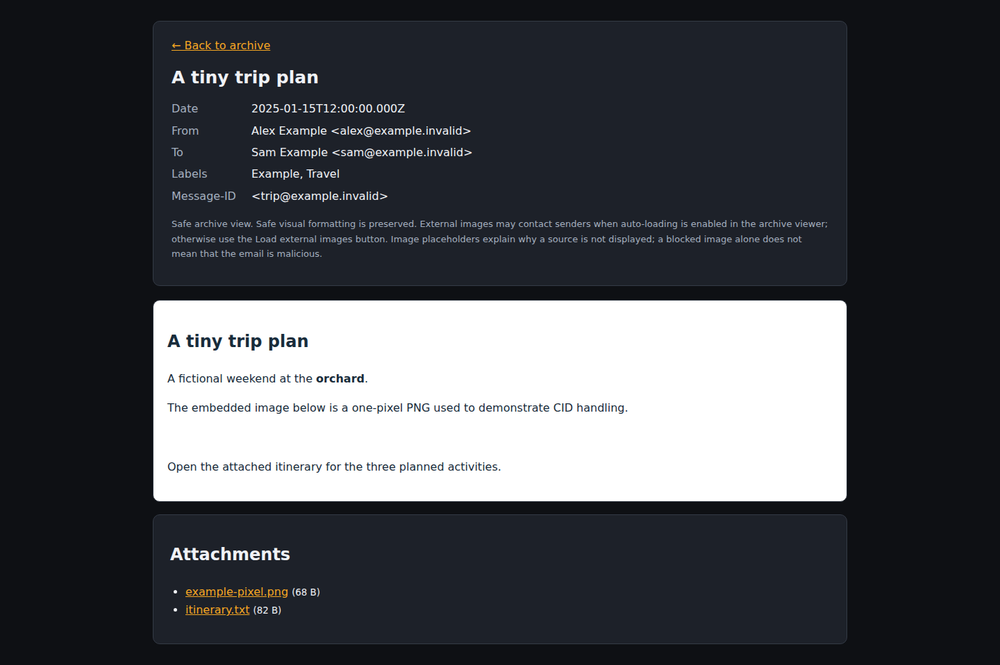

<div align="center">


# Freedom Email Archiver

**Your email. Your files. Your freedom.**

A private, portable, searchable email archive that runs right in your browser.

[](LICENSE)
[](#why-freedom-email-archiver)
[](https://github.com/nibage/freedom_email_archiver/actions/workflows/archive-tests.yml)

[Download ZIP](https://github.com/nibage/freedom_email_archiver/archive/refs/heads/main.zip) · [Quick start](#quick-start) · [User guide](#user-guide) · [Technical details](docs/TECHNICAL.md)

</div>


## Why Freedom Email Archiver?

Your email contains years of memories, documents and information. Keep a copy that you can open without an email provider, subscription, database server or internet connection.

| Feature | What it means for you |
| --- | --- |
| **Local and portable** | Everything lives in one folder. Copy it to another drive or computer. |
| **Searchable** | Find messages by subject, address, body text, account, Gmail label, date or attachments. |
| **Incremental imports** | Add new MBOX exports without duplicating existing messages. Gmail labels are merged. |
| **Readable files** | Each message is a standalone HTML file with its own local attachments. |
| **Multiple accounts** | Keep personal, work and other email archives together, or in separate portable folders. |
| **Recoverable indexes** | Removed accounts disappear automatically with archive access; copy complete indexed accounts or rebuild damaged indexes without an MBOX. |
| **Light & dark mode** | A compact, comfortable reading interface with remembered browsing position. |
| **Optional EML copies** | Preserve selected signed, encrypted, starred or important messages in original-message format. |

## See it in action

### Browse and search

The compact filter bar stays available while you scroll. Find the right message, open it and return to the same results page.


### Read your saved emails

Open messages directly in the browser, with local attachments and safe HTML formatting. The surrounding reader follows your selected theme.



### Import and maintain your library

Import MBOX files, select an account, choose optional EML retention and track progress. Check existing files or rebuild the index whenever needed.


*Screenshots use only the four fictional demonstration messages included in this repository.*

## Quick start

No installation or account is required.

1. [Download the ZIP](https://github.com/nibage/freedom_email_archiver/archive/refs/heads/main.zip) and extract it to a folder such as `freedom_email_archiver/`.
2. Open `index.html` in desktop Chrome or Edge.
3. Explore the four fictional example messages under **Browse archive**.
4. To add your own email, export an MBOX file using Google Takeout, Thunderbird or another MBOX-compatible tool.
5. Open **Import** and click **Enable archive access**. Select the folder containing `index.html`.
6. Select the MBOX file(s), choose an account and click **Start import**. Keep the tab open until it finishes.

> **Keep private mail private:** use a personal copy outside any Git repository you publish. The included examples are fictional; your real messages, attachments and indexes must never be published.

## User guide

### Everyday tasks

| I want to… | What to do |
| --- | --- |
| Read or search messages | Open `index.html` → Browse archive. No folder permission is required for indexed mail. |
| Add more email | Import another MBOX. Existing messages are not removed when absent from the new export. |
| Check saved files | Import → Enable archive access → **Check existing**. This is read-only. |
| Restore a missing index | Import → **Rebuild index**. No MBOX is needed. |
| Move or merge account folders | Back up first; complete indexed accounts can be adopted automatically. Rebuild only if indexes are missing, ambiguous or files inside an account changed. |
| Back up the entire archive | Copy the complete application folder, including its data. |

### Browse and search

Open `index.html` and choose **Browse archive**. Search by subject, address or message text and combine the account, Gmail label, date and attachment filters. Click an email to open its standalone HTML page. **Back to archive** or your browser's Back button restores your browsing position. Switch between light and dark mode in the header; older saved messages may retain their original appearance.

No folder permission is required for reading or searching an indexed archive. Remote email images can contact the sender's servers; disable **Load external images automatically** if you prefer.

### Import MBOX files

1. Open **Import** in desktop Chrome or Edge.
2. Click **Enable archive access** and select the application folder containing `index.html`, not `archived_emails/` or the MBOX file.
3. Select one or more MBOX files, then select an account or choose **+ New account…**.
4. Optionally retain EML copies for signed/encrypted, Gmail Starred or Gmail Important messages.
5. Click **Start import**, keep the tab open until it finishes, then return to Browse.

Import adds messages, skips duplicates and merges Gmail labels. Messages absent from a newer MBOX are not deleted. The source MBOX is unchanged; unrelated saved emails are not scanned or rewritten. Folder permission is remembered where the browser supports it; if it expires, use **Enable archive access** or **Renew archive access** again. Import, Check existing and Rebuild index never open a folder picker themselves.

### Check existing and Rebuild index

**Check existing** is read-only. It checks saved messages, attachments, EML copies and indexes for missing or damaged files.

**Rebuild index** reconstructs the searchable indexes from saved HTML, without changing emails, attachments or EML copies. Use it when an index is damaged or missing, or after manual changes to individual files inside an account. If rebuilding fails or is stopped before publication, the previous index is retained. Both actions show progress, require archive access, and do not require an MBOX or a preliminary check.

### Move, merge, delete or back up accounts

- **Move or rename the entire application folder:** keep `index.html`, `assets/` and `archived_emails/` together. All index paths are relative. Browsing and searching work at the new location without rebuilding. If necessary, renew folder access for writes.
- **Delete a whole account:** with write access, opening the app synchronizes the main and backup catalogs without rebuilding other accounts. Without write access, unavailable account indexes are skipped.
- **Copy or merge accounts:** back up first and preserve year/month, attachment, EML and catalog subfolders. A complete account with a valid index can be adopted automatically; missing or ambiguous indexes require Rebuild index. Resolve conflicts carefully; do not overwrite existing files blindly.
- **Recover emails without an index:** back up the saved files, copy account folders into `archived_emails/` and choose Rebuild index.
- **Create a separate archive or backup:** copy the entire application folder. Keep all synced files available offline, wait for synchronization to finish and never write to the same archive from multiple computers simultaneously.

The **GitHub** link in the application header opens this repository and its documentation in a separate tab. All archive functionality remains offline; only visiting the repository requires internet access.

## One portable archive

```text
freedom_email_archiver/
├── index.html              Open this
├── assets/                 Application and styling
└── archived_emails/        Your mail, attachments and indexes
    ├── catalog/
    ├── example/            Four fictional demonstration emails
    ├── personal/           Example of your own account
    └── work/               Example of another account
```

You can rename or move the complete folder. There is no separate data-root selector and no app installation inside each account.

The public repository also includes `docs/`, `tests/` and `scripts/` for documentation and development. These are not required to browse or import email.

## Privacy and limitations

- No cloud API, login, telemetry or server is required. External email images can contact remote servers; disable automatic loading if you prefer.
- Imported HTML is sanitized. Some formatting or active content may not be retained.
- Use desktop Chrome or Edge for folder access, imports and index maintenance. Other browsers have not been fully verified.
- The per-message limit is 64 MiB. Keep original MBOX exports for exact source preservation and signature verification.
- The archive is not encrypted. Protect private files and backups, and run only one write operation at a time, especially with synced folders.
- Oversized or damaged messages are reported as errors. Windows Defender warnings cannot be disabled by the application; review Windows Security → Protection history if a warning appears.

## Documentation & development

| Resource | Purpose |
| --- | --- |
| [User guide](#user-guide) | Step-by-step browsing, importing, recovery and backup |
| [Technical details](docs/TECHNICAL.md) | Architecture, indexes, duplicate handling, locking and EML preservation |
| [Testing and verification](tests/VERIFICATION.md) | How to run the automated checks and refresh screenshots |
| [Security](SECURITY.md) | Safe handling of private email and reporting issues |

Freedom Email Archiver is open source under the [MIT license](LICENSE). See [third-party notices](THIRD_PARTY_NOTICES.md) for bundled libraries.
